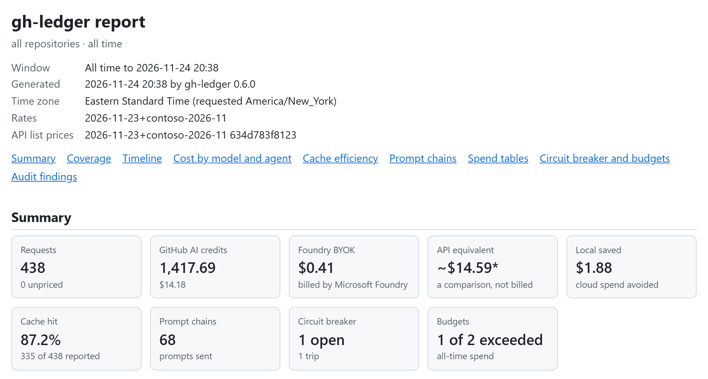

# gh-ledger

gh-ledger is a local ledger of what GitHub Copilot costs you. It records each request that Copilot CLI, the GitHub Copilot app, and VS Code make, through Copilot's OpenTelemetry export, and reports the spend by repository, branch, pull request, model, agent, and prompt.

It runs on your machine as the `gh ledger` GitHub CLI extension, with no Docker or cloud service, and it never stores prompt or response content. gh-ledger is an independent open-source project, not a GitHub product.



*An HTML report from `gh ledger export`, for a demo week in fictional repositories.*

## What it does

- **Tracks three kinds of spend:** GitHub AI credits, at the charge Copilot reports, or else at gh-ledger's rates; Microsoft Foundry BYOK spend in USD, at prices you give it; and local models, such as Ollama and Foundry Local, at $0.00 with the cloud spend they saved. Beside them, it shows what the same requests would cost at each model's API list prices.
- **Reports** spend by branch, agent, and prompt, and prompt-cache efficiency, as tables or JSON.
- **Backfills history** from the session logs of Copilot CLI, the GitHub Copilot app, and Codex.
- **Finds wasted spend:** request bursts, tool loops, retried failing commands, context bloat, prompt-cache misses, and premium models on trivial requests.
- **Shares results:** offline HTML reports, data bundles with SHA-256 hashes, and pull request receipts.
- **Guards branches** with soft budgets and a circuit breaker for runaway prompts.
- **Answers Copilot** through an MCP server, so an agent can check its own spend.

## Requirements

- The GitHub CLI (`gh`), or the .NET 10 SDK to build from source
- Windows, macOS, or Linux, on x64 or Arm64
- Copilot CLI, the GitHub Copilot app, or VS Code with Copilot
- Git repositories, for per-branch attribution. gh-ledger reads `.git` directly and never runs `git`.

## Get started

```shell
gh extension install swigerb/gh-ledger
gh ledger install
```

`install` turns on Copilot's telemetry export, starts the daemon, and registers it to start when you sign in. Restart the GitHub Copilot app, VS Code, and open terminals, send Copilot a prompt, and run `gh ledger status`. The [quickstart](docs/quickstart.md) tours every command.

## Privacy

The ledger stays on your machine. gh-ledger keeps metadata, such as models, token counts, times, costs, agent and tool names, and the repository, branch, and commit. It never stores prompts, responses, tool arguments or results, or file contents. See [What import reads and keeps](docs/cli.md#what-import-reads-and-keeps) and [What export includes](docs/cli.md#what-export-includes). `gh ledger audit --local-llm` sends only a summary of its findings, with repositories and branches replaced by aliases, and only to a model on your machine.

## Documentation

- [Quickstart](docs/quickstart.md): install, then every command in a few steps
- [User guide](docs/guide.md): tasks, with sample output
- [Command reference](docs/cli.md): every command and option, and troubleshooting
- [Configuration](docs/configuration.md): pricing, the rates overlay, and data files
- [PR receipt action](https://github.com/swigerb/copilot-ledger-action): post receipts on pull requests
- [Contributing](CONTRIBUTING.md): build, test, and send changes
- [Security policy](SECURITY.md): report a vulnerability privately
- [Releasing](docs/releasing.md): for maintainers
- [Test reports](docs/test-reports/): live end-to-end test results

## Build from source

To publish your own binary instead of the extension, see [Get gh-ledger](docs/cli.md#get-gh-ledger). To build and run the tests:

```shell
dotnet build CopilotLedger.slnx
dotnet test CopilotLedger.slnx
```

## License

MIT. See [LICENSE](LICENSE).
