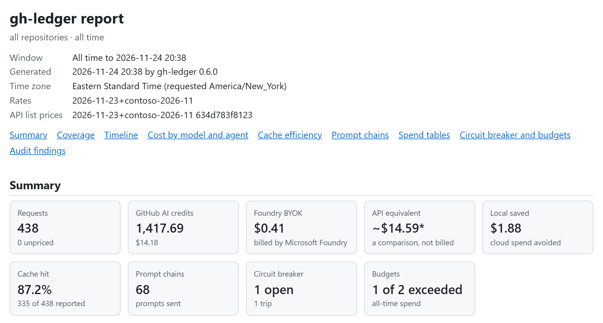

# gh-ledger command reference

gh-ledger runs a local OpenTelemetry receiver at `http://localhost:4318`, records GitHub Copilot's per-request usage in a SQLite ledger on your machine, and reports AI spend by repository, branch, pull request, model, agent, and prompt. To get started, see the [quickstart](quickstart.md). For walkthroughs, see the [user guide](guide.md).

This page writes commands as `gh ledger <command>`, the GitHub CLI extension. For a binary you built, run `<folder>/gh-ledger <command>`. gh-ledger keeps its files in `~/.copilot-ledger` (`%USERPROFILE%\.copilot-ledger` on Windows), or in the directory that `COPILOT_LEDGER_HOME` names; see [configuration.md](configuration.md).

## Commands at a glance

| Command | Purpose |
|---|---|
| [`install`, `uninstall`](#install-and-uninstall) | Turn on Copilot's telemetry export and start the daemon now and at sign-in, or undo that. |
| [`daemon run`, `daemon start`, `daemon stop`](#the-daemon) | Run the receiver in the foreground, start it in the background, or stop it. |
| [`status`, `branch`, `agents`, `top-prompts`](#reports) | Report the setup, and spend by period, branch, agent, or prompt chain. |
| [`status --cache`](#prompt-cache-efficiency) | Report prompt-cache efficiency and context bloat. |
| [`import`](#import-past-sessions) | Record past requests from Copilot and Codex session logs. |
| [`breaker status`, `breaker reset`, `breaker config`](#circuit-breaker) | Show, close, or configure circuit-breaker trips. |
| [`budget set`, `budget clear`, `budget list`](#budgets) | Manage soft AI-credit budgets for branches. |
| [`export-pr`](#pull-request-receipts) | Write the current branch's spend receipt for its pull request. |
| [`export`](#export-a-report) | Write an offline HTML report and, optionally, a ZIP of its data. |
| [`audit`](#audit-for-wasted-spend) | Find signs of wasted spend. |
| [`mcp`](#mcp-server) | Run the MCP server that lets Copilot read the ledger. |
| [`rates init`, `rates validate`, `rates update`, `rates backfill-api-equivalent`](#rates) | Create, check, and update rates, and price older requests at API list prices. |

## Common options

| Option | Meaning |
|---|---|
| `--since <period>` | `today`, `all`, `<N>d` (the last N days including today, 1 to 3650), or a `yyyy-MM-dd` date, from local midnight. The default is `30d`, except `7d` for `audit` and `all` for `import`. |
| `--repo <key>` | One repository: its `origin` remote's `owner/repo` path, its local root when there's none, or `(none)` for requests outside any repository. `import --repo` takes a folder path instead. |
| `--branch <name>` | One branch, or `(none)`. |
| `--pr <n>` | Requests on a branch whose Git config tracks `refs/pull/<n>/head`, as `gh pr checkout` sets up for some pull requests from forks. For other pull requests, use `--branch`. |
| `--json` | Write JSON. Amounts are exact decimals: parse them as decimals, not floats. Unknown values are `null`. |

gh-ledger reads Git context from the files in `.git`; it never runs `git`.

**Money columns.** `AI credits` and `GitHub USD` are GitHub AI credits and their value at $0.01 each. `BYOK USD` is Microsoft Foundry BYOK spend at your overlay's prices, and `Local saved` is the cloud spend that local models avoided; they bill $0.00. `Unpriced` counts requests without a billed price; see [Pricing statuses](configuration.md#pricing-statuses). A GitHub request costs the charge that Copilot reports for it (`github.copilot.nano_aiu`, or `totalNanoAiu` in a session log), which includes Auto and Copilot Fusion discounts; when that charge is missing or invalid, it costs the price from the rates in use. Tables round to cents.

`API equiv USD` is the same requests at API list prices: a comparison that budgets and the circuit breaker ignore; see [API-equivalent prices](configuration.md#api-equivalent-prices). There, `Unpriced` means that no request has a list price, `*` marks an amount that leaves some requests out, and `~` marks an estimate for requests without cache counters.

**Exit codes.** 0 means success, and 1 means invalid options, a refusal, or an error. 2 means that `import` coverage is incomplete, or that `audit --fail-on` found a finding at or above its severity.

## Get gh-ledger

```shell
gh extension install swigerb/gh-ledger
```

gh saves the binary as `%LOCALAPPDATA%\GitHub CLI\extensions\gh-ledger\gh-ledger.exe` on Windows, and as `~/.local/share/gh/extensions/gh-ledger/gh-ledger` elsewhere, or under `$XDG_DATA_HOME/gh` when that's set. Upgrades keep the path.

To check that this repository's Release workflow built the binary, verify its build provenance attestation; the command exits with 0 when an attestation matches the file's SHA-256 digest. Releases v0.5.0 and earlier have no attestations, and the Windows binaries aren't signed with Authenticode. See [Verify a release](releasing.md#verify-a-release).

```shell
gh attestation verify "<path to gh-ledger>" --repo swigerb/gh-ledger --signer-workflow swigerb/gh-ledger/.github/workflows/release.yml
```

To build from source, publish a self-contained binary for `win-x64`, `win-arm64`, `linux-x64`, `linux-arm64`, `osx-x64`, or `osx-arm64`, move it to a permanent folder, and run `<folder>/gh-ledger install`:

```shell
dotnet publish src/CopilotLedger.Cli/CopilotLedger.Cli.csproj -c Release -r <rid> -o artifacts/gh-ledger
```

## Install and uninstall

```text
gh ledger install [--dry-run]
gh ledger uninstall [--dry-run]
```

`install` records its changes in `install.json` and changes nothing else, such as `PATH`. It:

- Sets `COPILOT_OTEL_ENABLED=true`, as a user environment variable on Windows, or in a marked block of your shell profile elsewhere: `.zshrc` for zsh, `.bash_profile` (macOS) or `.bashrc` (Linux) for bash, and `.profile` otherwise.
- Registers the daemon to start when you sign in: the `CopilotLedger` value under `HKEY_CURRENT_USER\Software\Microsoft\Windows\CurrentVersion\Run` on Windows, `~/Library/LaunchAgents/io.github.swigerb.copilot-ledger.plist` on macOS, or `copilot-ledger.desktop` in `~/.config/autostart` (or `$XDG_CONFIG_HOME/autostart`) on Linux.
- Sets the `gh ledger` alias for a binary you built, when `gh` is on `PATH`. On Windows, the alias needs `sh.exe` from Git for Windows.
- Starts the daemon. If that fails, the other changes stay, and `install` exits with 1.

Then restart the GitHub Copilot app, VS Code, and open terminals. `--dry-run` prints the changes without making them, and exits with the code that `install` would. For the daemon, it says that it's already running, with its pid; or, in a terminal whose Windows job would stop it, `Wouldn't start the gh-ledger daemon:` with the reason and hint that `daemon start` gives; or `Would start the gh-ledger daemon.`

`install` and `status` warn about variables that keep telemetry from reaching gh-ledger, such as an `OTEL_EXPORTER_OTLP_ENDPOINT` other than `http://localhost:4318` or `http://127.0.0.1:4318`. `install` also warns that the daemon started at sign-in sees `COPILOT_LEDGER_HOME` only if your sign-in environment sets it. `status` warns when `install.json` names another executable; run `install` from the copy you want to keep.

`uninstall` stops the daemon, removes the sign-in item, and reverses the variable, profile, and alias changes. Your ledger stays, and so does an MCP registration: run `copilot mcp remove ledger`, and remove `ledger` from VS Code's `mcp.json` if you added it. Then `gh extension remove ledger` removes the extension.

**Upgrading or removing the extension.** On Windows, gh can't replace or delete the binary while the daemon or a Copilot session's `ledger` MCP server runs it, so `gh extension upgrade ledger` and `gh extension remove ledger` fail. First stop the daemon, and close the Copilot sessions and apps that use the MCP server.

**Ledger format.** gh-ledger upgrades the ledger to format 7 the first time it opens it, and gh-ledger 0.5.0 and earlier can't open the ledger after that: they stop with `Database user_version <n> is newer than the supported version <m>.` After upgrading, run `gh ledger import --all` once to repair earlier imports and charges and to learn the names of MCP tools; see [Repairs](#repairs). That can't be undone, so copy your data directory first. To go back to an earlier release, stop the daemon, run `gh extension remove ledger` and `gh extension install swigerb/gh-ledger --pin <tag>`, put the copy in place of your data directory, and start the daemon.

**Upgrading from 0.5.0.** gh-ledger 0.5.0 uses ledger format 6 and can't open a format 7 ledger. Close the Copilot sessions and apps that use the MCP server, stop the daemon, copy your data directory, upgrade, start the daemon, and run `gh ledger import --all` once, as these steps show. To go back, stop the daemon, run `gh extension remove ledger` and `gh extension install swigerb/gh-ledger --pin v0.5.0`, put the copy in place of your data directory, and start the daemon. The copy lacks what gh-ledger recorded after you made it.

**Upgrading from 0.6.0.** gh-ledger 0.6.0 uses ledger format 7 too, so it can still open the ledger after you upgrade. Follow the steps below; the first `gh ledger import --all` reads every session log again to learn the names of MCP tools. To go back, stop the daemon, run `gh extension remove ledger` and `gh extension install swigerb/gh-ledger --pin v0.6.0`, and start the daemon; you don't need the copy.

```shell
gh ledger daemon stop
```

Copy the whole data directory, not only `ledger.db`, so that a `ledger.db-wal` file with the latest changes comes with it. In PowerShell:

```powershell
$data = if ($env:COPILOT_LEDGER_HOME) { $env:COPILOT_LEDGER_HOME } else { "$HOME\.copilot-ledger" }
Copy-Item -LiteralPath $data -Destination "$HOME\copilot-ledger-backup-$(Get-Date -Format yyyyMMdd-HHmmss)" -Recurse
```

On macOS and Linux:

```shell
cp -R "${COPILOT_LEDGER_HOME:-$HOME/.copilot-ledger}" "$HOME/copilot-ledger-backup-$(date +%Y%m%d-%H%M%S)"
```

Then upgrade, start the daemon, and repair:

```shell
gh extension upgrade ledger
gh ledger daemon start
gh ledger import --all
```

## The daemon

```text
gh ledger daemon run [--port <port>] [--log-file <path>]
gh ledger daemon start [--port <port>]
gh ledger daemon stop
```

The daemon is the OTLP/HTTP receiver: it listens only on localhost, and prices and records each request as it arrives. `daemon run` runs it in the foreground. `daemon start` runs it in the background, logging to `daemon.log` in the data directory, and waits up to 15 seconds for it to start. `daemon stop` asks it to stop, and ends its process if it's still running after 15 seconds.

| Option | What it does |
|---|---|
| `--port <port>` | The port, from 1 to 65535. The default, 4318, is where Copilot sends telemetry unless `OTEL_EXPORTER_OTLP_ENDPOINT` says otherwise. |
| `--log-file <path>` | `daemon run` only: append the log to this file instead of standard output. |

Only one daemon runs at a time: `daemon start` reports a running one and exits with 0, and `daemon run` exits with 1. If the daemon can't start, `daemon start` exits with 1, and `daemon.log` says why. Requests made while no daemon runs are recorded only if you [import](#import-past-sessions) them.

On Windows, a terminal can run in a job that stops its processes when it closes, as the GitHub Copilot app's agent terminals do. When the job lets processes leave it, the daemon leaves it and starts normally. When it doesn't, or its settings can't be read, `daemon start` starts nothing, exits with code 1, and says:

```text
gh-ledger daemon not started: this terminal runs in a Windows job that stops the processes it started when it closes, so the daemon would stop with it.
Run gh ledger daemon start from a regular terminal, or sign out and back in to start it from the sign-in item.
```

`install` refuses the same way after its other changes. The second line leaves out the sign-in part when there's no sign-in item, and says `gh-ledger` for a binary you built. `daemon run` isn't refused: it logs a `Warning:` line and stops when the terminal closes. A daemon started from a job nested in another job can still be stopped by the outer job; it then logs the same warning when it starts.

## Reports

```text
gh ledger status [--json] [--pricing <path>]
gh ledger branch [--repo <key> | --all-repos] [--since <period>] [--json] [--pricing <path>]
gh ledger agents [--repo <key>] [--since <period>] [--json] [--pricing <path>]
gh ledger top-prompts [--repo <key>] [--since <period>] [--limit <n>] [--json] [--pricing <path>]
```

| Command | Shows | Options besides `--json` and `--pricing` |
|---|---|---|
| `status` | The version, daemon, ledger path, rates version, Copilot's export setting, and warnings; then spend, spend at API list prices, and the cache hit ratio for today and the last 7 and 30 days. | None, or `--cache` for [prompt-cache efficiency](#prompt-cache-efficiency) |
| `branch` | Spend by branch in the current repository, or in every repository outside one | `--repo`, `--all-repos`, `--since` |
| `agents` | Spend by agent in every repository; `(none)` is requests without an agent name | `--repo`, `--since` |
| `top-prompts` | The prompt chains with the most billed spend, in every repository. A prompt chain is a prompt and the requests it led to, which share a trace ID. | `--repo`, `--since`, `--limit` (1 to 100, default 10) |

`status`'s `GitHub/API` column divides GitHub USD by the same requests' API-equivalent amount, such as `0.80x`; it's `n/a` unless every GitHub-billed request in the period has both prices. `--pricing <path>` reprices only the API-equivalent amounts, with another complete rates file such as a negotiated price list, and saves nothing; see [Compare with other prices](configuration.md#compare-with-other-prices---pricing).

## Prompt-cache efficiency

```text
gh ledger status --cache [--by model|branch|pr|agent] [--repo <key>] [--branch <name>] [--pr <n>] [--since <period>] [--json]
gh ledger status --cache --turns (--trace <traceId> | --conversation <id>) [--json]
gh ledger status --cache --bloat [--repo <key>] [--since <period>] [--limit <n>] [--json]
```

| Option | What it does |
|---|---|
| `--by` | Group by `model` (the default), `branch`, `pr`, or `agent`. With `pr`, requests without a pull request number show as `(no PR) <branch>`. |
| `--turns` | List each request of a prompt chain (`--trace`, 32 hexadecimal digits) or a Copilot session (`--conversation`), with `Growth`: the change in input from the previous request of the same agent invocation and model, or `n/a` without a recorded invocation, as for imported requests. |
| `--bloat` | Rank prompt chains by uncached input and by input growth, and rank chains with requests that reported no cache counters by estimated uncached input. `--limit` sets each ranking's length, from 1 to 100 (default 10). |

`Uncached` is input minus cache reads and writes. `Hit %` is cache reads divided by input, over the requests that reported cache counters (`Cache reported`). Copilot reports a counter only when it isn't zero, so a request with neither is unknown, not a miss; for a provider that never reports cache writes, misses look unknown too, and `Hit %` runs high. `n/a` means that no request reported counters, and `*` marks a partial total. `--pricing` can't be used with `--cache`. See [Find context bloat](guide.md#find-context-bloat).

## Import past sessions

`gh ledger import` records requests from the session logs that Copilot CLI and the GitHub Copilot app keep, and from Codex's if you ask, such as requests made before you installed gh-ledger or while the daemon wasn't running. It prices them with the rates in use as of their start time ([Imported requests](configuration.md#imported-requests)), keeps the Git context their log recorded, and counts them everywhere that live requests count. See [Backfill history after installing](guide.md#backfill-history-after-installing).

```text
gh ledger import (--repo <path> | --all) [--source copilot|codex]... [--since <period>] [--dry-run] [--include-active] [--json]
```

| Option | What it does |
|---|---|
| `--repo <path>` or `--all` | Import requests made in the Git repository at `<path>`, such as `.`, or everywhere. One is required. |
| `--source` | `copilot`, the default, reads `session-state` in `~/.copilot` or `COPILOT_HOME`; `codex` reads `sessions` and `archived_sessions` in `~/.codex` or `CODEX_HOME`. Repeat the option for both. `claude` is refused: Claude Code's log format is undocumented. |
| `--since` | Skip logs last written, and requests started, before the period. The default is `all`. |
| `--dry-run` | Report what would be recorded, without creating or changing the ledger. |
| `--include-active` | Also read open Copilot sessions, which are otherwise skipped until they end. |
| `--json` | Write the report as JSON, with every warning in `diagnostics`. |

| Source | Versions read | Not imported |
|---|---|---|
| Copilot CLI and the GitHub Copilot app | 1.0.103 to 1.0.115 | Sessions that an earlier version started, which log only totals; later versions, until supported; earlier journal files |
| Codex | 0.153.0 to 0.171.0 | Compressed rollouts (`.jsonl.zst`); tool calls; requests that a forked rollout copied from another thread |

Tool calls are imported only from the last 7 days.

### Overlap with live spans

Each request counts once, and the live span wins. GitHub-billed requests and compactions carry a service request ID that their live spans share (`github.copilot.service_request_id`), so import skips one when a live span or an earlier import has its ID (`Overlap-skipped`, `Duplicate`). Requests without the ID, such as Copilot BYOK and Codex requests, are recorded only from sessions without live spans, and deferred otherwise (`Ambiguous-overlap`). A live span that arrives later replaces the imported row. Rows replaced without a matching ID show as `Superseded, unmatched` and leave coverage incomplete, because the live spans may not cover them all.

Importing again records nothing twice and finishes a stopped import. `import` refuses to run, with exit code 1, while an earlier gh-ledger's daemon runs, because that daemon doesn't follow these rules; restart the daemon first.

### Repairs

When an import reads a log that an earlier gh-ledger imported, it repairs what was recorded from it: it reprices imported requests with the rates in use (`Repriced`), gives live requests that the daemon priced at the rate card the valid charge their log reports (`Live repriced`), and moves tool calls attached to the wrong request (`Tool links relinked`; tool calls older than 7 days aren't kept). Each request keeps its list price beside its charge. A dry run reports the same counts and changes nothing. An import also reads once more each log that gh-ledger 0.6.0 or earlier imported, to learn the names of the MCP tools that ran in it; see [MCP tool names](#mcp-tool-names).

### MCP tool names

Copilot CLI's live spans name a tool from an MCP server by two lowercase hexadecimal SHA-256 hashes, of the server's name and of the tool's name, joined by `/`. Its session log names the tool in clear, so each import learns the name from the logs it reads: `data.toolName` of `tool.execution_start`, such as `computer-use-exec_js`, the name that imported tool calls show. Export, audit, and the MCP server show it for live calls too. A tool that no log has named yet shows as `MCP tool` and the first 8 digits of each hash, such as `MCP tool 10be6bee/8453dc19`. The ledger keeps the hashes, and the audit's tool rules group calls by them.

### The import report

For each source, the report counts the logs and requests that import read, recorded, skipped, deferred, rejected, and repaired. Warnings on standard error name the session or rollout and the line and byte of each problem, never the log's content.

| Exit code | Meaning |
|---|---|
| 0 | Every source's coverage is complete. |
| 2 | The import finished, but some coverage is incomplete; the warnings say why. Everything that could be imported was. |
| 1 | The options or the rates overlay are invalid, an earlier gh-ledger's daemon is running, or an error stopped the import. |

Coverage is incomplete when a session store can't be listed, a log is unsupported, a line or usage record can't be read, a request is deferred or superseded without a match, a cost exceeds the ledger's range of about $9.2 million, or a session has earlier journal files. Skipped logs don't affect it. Sessions from before Copilot CLI 1.0.103 are never imported; when they're the only gap, the report suggests `--since` to leave them out.

### What import reads and keeps

These are the only fields import keeps, and where each comes from. Fields in no column are never stored.

<!-- import-allowlist -->
| Ledger column | Copilot session log | Codex rollout |
|---|---|---|
| `spans.ingest_source` | `import:copilot` | `import:codex` |
| `spans.trace_id` | SHA-256 of the session ID and the usage ID (`data.usage.accounting.usageId`) of the prompt's first request, which `data.usage.initiator` `user` marks | SHA-256 of the session ID and `payload.root_turn_id`, or `payload.turn_id` |
| `spans.span_id` | SHA-256 of the session ID and `data.usage.accounting.usageId`, or a compaction's `data.serviceRequestId`, or a BYOK compaction's `data.compactionAttemptId` | SHA-256 of the session ID and `payload.response_id` |
| `spans.operation_name` | `chat` | `chat` |
| `spans.conversation_id` | The session ID, `data.sessionId` of `session.start` | `payload.session_id` of `session_meta` |
| `spans.agent_name` | `data.agentName` of the `subagent.started` event that the record's `agentId`, or its `data.usage.parentToolCallId`, names | `payload.agent_role` of `session_meta` |
| `spans.provider_name` | `github`; for BYOK, `data.usage.providerType` in lowercase | `payload.model_provider` of `session_meta` in lowercase, with `lmstudio` as `lm_studio` |
| `spans.request_model` | `data.usage.model`; for a compaction, `data.compactionTokensUsed.model` | `payload.model` of the turn's `turn_context` |
| `spans.response_model` | `data.usage.responseModel` | — |
| `spans.start_time_unix_ms`, `spans.end_time_unix_ms` | The event's `timestamp` less `data.usage.duration` (`data.compactionTokensUsed.duration`), and the `timestamp` | `timestamp` |
| `spans.input_tokens`, `spans.output_tokens`, `spans.cache_read_input_tokens`, `spans.cache_write_input_tokens` | `data.usage.inputTokens`, `outputTokens`, `cacheReadTokens`, and `cacheWriteTokens` (under `data.compactionTokensUsed` for a compaction) | `payload.usage.input_tokens`, `output_tokens`, `cached_input_tokens`, and `cache_write_input_tokens` (0 when absent) |
| `spans.cache_read_state`, `spans.cache_write_state` | `data.usage.cacheDetailsReported`, or a count above 0; reported for a compaction | Reported; cache writes only when `cache_write_input_tokens` is present |
| `spans.repo_root` | `data.context.gitRoot` of `session.start`, or of the latest `session.resume` | — |
| `spans.repo_slug` | `data.context.repository`: an `owner/repo` slug, or the slug of a remote URL, credentials removed | The slug of `payload.git.repository_url`, credentials removed |
| `spans.branch_name`, `spans.head_commit_sha` | `data.context.branch` and `data.context.headCommit` | `payload.git.branch` and `payload.git.commit_hash` |
| `spans.canonical_usage_id` | SHA-256 of `data.usage.serviceRequestId`, or of a compaction's `data.serviceRequestId`; none for BYOK | — |
| `spans.imported_tool_call_count` | `data.usage.numToolCalls`, or none when it's missing or invalid; 0 for a compaction, which makes no tool calls | — |
| `spans.model_id`, `spans.rate_card_model_id`, `spans.tier_name`, `spans.billing_channel`, `spans.pricing_status`, `spans.rates_version`, `spans.cost_usd_pico` (the reported charge when `charge_source` is `reported`), `spans.saved_usd_pico`, `spans.api_equivalent_usd_pico`, `spans.api_equivalent_status`, `spans.api_rate_card_model_id`, `spans.api_rates_version`, `spans.api_rate_card_sha256` | Priced from the fields above, as for live spans | Priced from the fields above, as for live spans |
| `spans.list_cost_usd_pico` | The rate card's price, from the fields above | Priced from the fields above |
| `spans.charge_source` | `reported` when `data.usage.copilotUsage.totalNanoAiu`, or a compaction's `data.compactionTokensUsed.copilotUsage.totalNanoAiu`, is a valid charge for a priced GitHub request; `rejected` when it's present but not; else `rate_card` | `rate_card` |
| `spans.id`, `spans.recorded_at_unix_ms`, `spans.accounting_state`, `spans.superseded_by` | Kept by the ledger | Kept by the ledger |
| `span_links.trace_id`, `span_links.conversation_id`, `span_links.owner_span_row_id` | The usage record whose response asked for the tool: the one whose `data.usage.apiCallId` (or usage ID) equals `data.apiCallId` of the `assistant.message` that the tool's `parentId` chain reaches through tool events; when the chain doesn't reach one, the latest usage record of the tool's agent | — |
| `span_links.span_id` | SHA-256 of the session ID and `data.toolCallId` | — |
| `span_links.operation_name` | `execute_tool` | — |
| `span_links.agent_name` | As `spans.agent_name`, from the tool's `agentId` or `data.parentToolCallId` | — |
| `span_links.start_time_unix_ms`, `span_links.tool_name` | `timestamp` and `data.toolName` of `tool.execution_start` | — |
| `span_links.tool_exit_code`, `span_links.status_code` | `data.shellExecution.exitCode` and `data.success` of `tool.execution_complete` | — |
| `span_links.recorded_at_unix_ms` | Kept by the ledger | — |
| `import_sessions.source`, `import_sessions.log_id` | `copilot`, and the session folder's name | `codex`, and the IDs in the rollout's file name, after `archived/` for an archived rollout |
| `import_sessions.log_size_bytes`, `import_sessions.log_last_write_unix_ms`, `import_sessions.log_sha256` | The log file's size and last-write time, and the SHA-256 hash of its bytes up to that size | The rollout file's size and last-write time, and the SHA-256 hash of its bytes up to that size |
| `import_sessions.complete`, `import_sessions.records_recorded`, `import_sessions.records_duplicate`, `import_sessions.records_overlap`, `import_sessions.records_ambiguous`, `import_sessions.imported_at_unix_ms`, `import_sessions.import_revision` | The import's own results | The import's own results |
| `import_record_aliases.source`, `import_record_aliases.record_key_sha256` | `copilot`, and SHA-256 of the record's usage ID, or of a compaction's service request ID, or a BYOK compaction's `data.compactionAttemptId` | `codex`, and SHA-256 of `payload.response_id` |
| `import_record_aliases.span_row_id`, `import_record_aliases.resolution`, `import_record_aliases.recorded_at_unix_ms` | Kept by the ledger | Kept by the ledger |
| `mcp_tool_names.hashed_name` | The name that Copilot CLI's live spans give an MCP tool: the SHA-256 of `data.mcpServerName` of `tool.execution_start`, `/`, and the SHA-256 of its `data.mcpToolName`, in lowercase hexadecimal | — |
| `mcp_tool_names.tool_name` | `data.toolName` of the same `tool.execution_start`; when logs name one tool differently, the first in ordinal order | — |
<!-- /import-allowlist -->

- **Read, never stored:** each line's `type`. From Copilot logs: `data.producer`, `data.version`, and `data.copilotVersion` of `session.start`; the working directory, `data.context.cwd`, which only `--repo` uses; each event's `agentId`, and `data.toolCallId` of `subagent.started`, which tie a sub-agent's events to its name; `data.usage.isByok`, `data.usage.provider.kind`, `data.usage.initiator`, and `data.usage.parentToolCallId` of usage records; and `data.success`, `data.compactionTokensUsed.requestCount`, and `data.compactionTokensUsed.provider.kind` of compactions, which decide how a record is read. The envelope `id` and `parentId` of `assistant.message`, `tool.execution_start`, and `tool.execution_complete`, `data.apiCallId` of `assistant.message`, and `data.usage.apiCallId` of usage records tie a tool call to the request that asked for it. `data.usage.copilotUsage.totalNanoAiu` of usage records and `data.compactionTokensUsed.copilotUsage.totalNanoAiu` of compactions, the charge Copilot reports for the request, are kept only as that charge in `spans.cost_usd_pico` and as `spans.charge_source`. `data.compactionAttemptId` of compactions is stored only as the SHA-256 hashes above, and whether `data.compactionTokensUsed.provider` and `data.compactionTokensUsed.copilotUsage` are present decides how a compaction is read. Usage IDs, service request IDs, tool call IDs, and `data.mcpServerName` and `data.mcpToolName` of `tool.execution_start` are stored only as the SHA-256 hashes above. From Codex rollouts: `payload.id` (the thread ID), `payload.cli_version`, and `payload.cwd` of `session_meta`; `payload.turn_id` of `turn_context`, which ties each turn's model to its records; and `payload.thread_id`, `payload.session_id`, `payload.turn_id`, and `payload.root_turn_id` of `token_usage_record`.
- **Never read:** every other field and event, including message content (`content`, `transformedContent`), reasoning (`reasoningText`, `reasoningOpaque`, `reasoningBlocks`, `encryptedContent`), tool requests (`toolRequests`), tool arguments and results, error messages, compaction summaries (`summaryContent`), checkpoint paths, instructions, and attachments. Import skips a line once its `type` shows that it isn't one of the events above, and reads logs in place.

## Circuit breaker

The daemon checks each prompt chain as its live spans arrive, and trips the breaker when the chain breaks a rule:

- **Credit velocity:** billed spend, GitHub AI credits plus Foundry BYOK at $0.01 per credit, exceeds 150 AI credits within 5 minutes.
- **Retry churn:** 5 failed tool calls in a row, each with a non-zero exit code or an error status, and no successful command or new commit between them.

A trip writes an `ALERT` line to `daemon.log` and shows a desktop notification, which on Linux needs `notify-send`; it doesn't stop the agent. Each rule trips once for a prompt chain, and the trip stays open until you reset it. `import` never trips the breaker.

```text
gh ledger breaker status [--json]
gh ledger breaker reset [--id <id> | --all | --repo <key> --branch <name>]
gh ledger breaker config [--velocity-credits <n>] [--velocity-minutes <n>] [--churn-failures <n>] [--flag-file on|off] [--notifications on|off]
```

| Command or option | What it does |
|---|---|
| `breaker status` | Show the rules and the open trips. |
| `breaker reset` | Close the current branch's open trips, one trip (`--id`), another branch's (`--repo` and `--branch`), or all (`--all`). |
| `breaker config` | Show the rules, or change them with these options. |
| `--velocity-credits` | 1 to 1,000,000 AI credits, with up to 2 decimal places. The default is 150. |
| `--velocity-minutes` | 1 to 1,440. The default is 5. |
| `--churn-failures` | 2 to 100. The default is 5. |
| `--notifications off` | Keep the `ALERT` line, but stop desktop notifications. |
| `--flag-file on` | While a trip is open, write the open trips as JSON to `.copilot-ledger/CIRCUIT_OPEN` in the repository root, which Git ignores, so that a wrapper script can stop an agent. `breaker reset` removes it. |

## Budgets

```text
gh ledger budget set <credits> [--repo <key> --branch <name>]
gh ledger budget clear [--repo <key> --branch <name>]
gh ledger budget list [--json]
```

A budget is a soft cap in AI credits for one branch. When the branch's all-time billed spend, with Foundry BYOK at $0.01 per credit, exceeds it, the daemon alerts once, as for a breaker trip, when a live span for the branch arrives. Nothing is blocked. `budget set` takes more than 0 and up to 1,000,000 credits, with up to 2 decimal places, and re-arms the alert. `set` and `clear` act on the current branch unless you pass both `--repo` and `--branch`. `budget list` shows each budget and its spend.

## Pull request receipts

```text
gh ledger export-pr [--stdout | --json] [--pricing <path>]
```

`gh ledger export-pr` writes the current branch's AI spend receipt to `.github/copilot-ledger/receipts/<branch>-<hash>.md`. Commit and push it, and the [PR receipt action](https://github.com/swigerb/copilot-ledger-action) posts it on the pull request. The receipt covers all the branch's recorded spend by billing channel and model, with breaker trips, the most expensive prompt, and the data as JSON; its totals equal the branch's row in `gh ledger branch --since all --json`.

| Option | What it does |
|---|---|
| `--stdout` | Write the Markdown to standard output instead of the file. |
| `--json` | Write the JSON data to standard output instead of the file. |
| `--pricing <path>` | Reprice the API-equivalent amounts, as the reports do. |

It needs a branch with a commit and an `origin` remote with an `owner/repo` path, and it refuses a receipt over 65,536 bytes, the most that the action posts.

## Export a report

`gh ledger export` writes one HTML file that shows the spend of a repository, branch, pull request, or Copilot session, and opens offline in any browser. `--bundle` also writes a ZIP with the report, a manifest of SHA-256 hashes, and the data as JSON. See [Attach a cost report to a pull request](guide.md#attach-a-cost-report-to-a-pull-request).



For a screenshot of each part of the report, see [Attach a cost report to a pull request](guide.md#attach-a-cost-report-to-a-pull-request).

```text
gh ledger export [--format html] [--out <path>] [--bundle] [--repo <key> | --all-repos] [--branch <name>] [--pr <n>]
                 [--conversation <id>] [--since <period>] [--time-zone <id>] [--include-local-paths]
                 [--max-timeline-spans <n>] [--generated-at <UTC time>] [--force]
```

| Option | Default | What it does |
|---|---|---|
| `--format` | `html` | The only format. |
| `--out` | `copilot-ledger-report.html` | The report file, ending in `.html` or `.htm`, in an existing folder. |
| `--bundle` | | Also write the ZIP beside the report, with the same name ending in `.zip`. |
| `--repo` or `--all-repos` | The current repository | One or every repository; outside a repository, every one. |
| `--branch`, `--pr`, `--conversation` | | One branch, pull request, or Copilot session. |
| `--since` | `30d` | The period, in the export's time zone. |
| `--time-zone` | This computer's | An IANA time zone ID, such as `America/New_York`. On Windows, Windows IDs also work, and IANA IDs need Windows 10 version 1903 or later. |
| `--include-local-paths` | | Show local roots of repositories without an `owner/repo` remote, instead of folder names. |
| `--max-timeline-spans` | `20000` | The most requests, and tool calls, that the timeline draws: the latest, 0 to 100,000. Totals include them all. |
| `--generated-at` | Now | The UTC generation time to record, such as `2026-11-21T21:30:00Z`, to reproduce an export. |
| `--force` | | Replace existing files that aren't read-only. |

The report shows summary cards, coverage notes, a zoomable timeline of each session's requests and tool calls, cost by model and agent, cache efficiency, prompt chains, spend tables, breaker trips and budgets, and up to 100 audit findings. It loads nothing and works without JavaScript. Tool calls and findings name MCP tools as [MCP tool names](#mcp-tool-names) describes. Standard output names the files, request count, scope, and period, never a folder. With an invalid rates overlay, export warns and leaves `premium_model_trivial_turn` and repriced estimates out of the findings.

### The bundle

The ZIP holds `manifest.json`, `report.html`, and five `telemetry/` files: `audit-findings.json`, `prompt-chains.json`, `spans.json`, `summary.json`, and `tool-calls.json`, with every request, tool call, and finding, however many the report draws.

```json
{
  "schemaVersion": 1,
  "tool": "gh-ledger",
  "toolVersion": "0.7.0",
  "generatedAtUtc": "2026-11-21T21:30:00.0000000+00:00",
  "ratesVersions": ["2026-11-23"],
  "apiRateCards": [{ "ratesVersion": "2026-11-23", "sha256": "<64 hexadecimal digits>" }],
  "filter": { "repo": "contoso/webapp", "allRepositories": false, "branch": "feature/search", "pr": null, "conversation": null, "since": "30d", "period": "last 30 days", "fromUtc": "…", "toUtc": "…" },
  "timeZone": { "requested": null, "id": "…", "nightStartLocal": "18:00", "nightEndLocal": "06:00", "nightBandsUtc": [] },
  "options": { "maxTimelineSpans": 20000, "includeLocalPaths": false },
  "privacy": { "contentFree": true, "localPathsIncluded": false, "excluded": ["prompts", "responses", "tool arguments", "tool results", "file contents", "remote URLs"] },
  "files": [{ "path": "report.html", "bytes": 123456, "sha256": "<64 hexadecimal digits>" }],
  "coverage": { "requestsComplete": true, "warnings": [], "…": "…" }
}
```

`files` lists the other six files' sizes and SHA-256 hashes. The same gh-ledger build on the same operating system writes the same bytes from an unchanged ledger: repeat the filters, with `--generated-at` set to `generatedAtUtc` and `--time-zone` to `timeZone.requested`, or `timeZone.id` when that's `null`. This doesn't work when `filter.repo` is a folder name, which `--repo` can't select.

### What export includes

These are the only fields export writes. In the table, `.` is a file's top level, a name is a nested object, and `name[]` is each object of an array. `report.html` means its `ledger-data` block. `repositoryRoot` is written only with `--include-local-paths`.

<!-- export-allowlist -->
| File | Object | Fields |
|---|---|---|
| `manifest.json` | `.` | `schemaVersion`, `tool`, `toolVersion`, `generatedAtUtc`, `ratesVersions`, `apiRateCards`, `filter`, `timeZone`, `options`, `privacy`, `files`, `coverage` |
| `manifest.json` | `apiRateCards[]` | `ratesVersion`, `sha256` |
| `manifest.json` | `options` | `maxTimelineSpans`, `includeLocalPaths` |
| `manifest.json` | `privacy` | `contentFree`, `localPathsIncluded`, `excluded` |
| `manifest.json` | `files[]` | `path`, `bytes`, `sha256` |
| `report.html` | `.` | `schemaVersion`, `generatedAtUtc`, `toolVersion`, `filter`, `timeZone`, `timeline`, `coverage` |
| `report.html` | `timeline` | `fromUtc`, `toUtc`, `width`, `minWidth`, `ticks` |
| `report.html` | `timeline.ticks[]` | `x`, `level`, `label` |
| `manifest.json`, `report.html` | `filter` | `repo`, `allRepositories`, `branch`, `pr`, `conversation`, `since`, `period`, `fromUtc`, `toUtc` |
| `manifest.json`, `report.html` | `timeZone` | `requested`, `id`, `nightStartLocal`, `nightEndLocal`, `nightBandsUtc` |
| `manifest.json`, `report.html` | `timeZone.nightBandsUtc[]` | `fromUtc`, `toUtc` |
| `manifest.json`, `report.html`, `telemetry/summary.json` | `coverage` | `requestsComplete`, `warnings`, `spans`, `spansBySource`, `supersededMatchedImportSpans`, `supersededUnmatchedImportSpans`, `ledgerAmbiguousImportRecords`, `ledgerIncompleteImportLogs`, `unpricedSpans`, `apiEquivalentUnpricedSpans`, `apiEquivalentEstimatedSpans`, `cacheReportedSpans`, `cacheAbsentSpans`, `cacheLegacyUnknownSpans`, `toolHistory`, `timeline` |
| `manifest.json`, `report.html`, `telemetry/summary.json` | `coverage.spansBySource[]` | `source`, `spans` |
| `manifest.json`, `report.html`, `telemetry/summary.json` | `coverage.toolHistory` | `complete`, `retentionDays`, `retainedFromUtc`, `spansBeforeRetention`, `importedToolCallsWithoutDetail`, `importedRequestsWithoutToolData` |
| `manifest.json`, `report.html`, `telemetry/summary.json` | `coverage.timeline` | `truncated`, `maxSpans`, `spans`, `spansDrawn`, `toolCalls`, `toolCallsDrawn` |
| `telemetry/summary.json` | `.` | `schemaVersion`, `totals`, `byModel`, `byAgent`, `byBranch`, `byChannelModel`, `cacheByModel`, `cacheByAgent`, `breakerTrips`, `budgets`, `coverage` |
| `telemetry/summary.json` | `totals` | `spans`, `unpricedSpans`, `inputTokens`, `outputTokens`, `cacheReadInputTokens`, `cacheWriteInputTokens`, `aiCredits`, `aiCreditsUsd`, `foundryByokUsd`, `localSavedUsd`, `apiEquivalentUsd`, `apiEquivalentUnpricedSpans`, `apiEquivalentEstimatedSpans`, `cacheReportedSpans`, `cacheUnreportedSpans`, `cacheHitRatio`, `promptChains` |
| `telemetry/summary.json` | `byModel[]` | `model`, `spans`, `unpricedSpans`, `inputTokens`, `outputTokens`, `cacheReadInputTokens`, `cacheWriteInputTokens`, `aiCredits`, `aiCreditsUsd`, `foundryByokUsd`, `localSavedUsd`, `apiEquivalentUsd`, `apiEquivalentUnpricedSpans`, `apiEquivalentEstimatedSpans`, `cacheReportedSpans`, `cacheUnreportedSpans`, `cacheHitRatio` |
| `telemetry/summary.json` | `byAgent[]` | `agent`, `spans`, `unpricedSpans`, `inputTokens`, `outputTokens`, `cacheReadInputTokens`, `cacheWriteInputTokens`, `aiCredits`, `aiCreditsUsd`, `foundryByokUsd`, `localSavedUsd`, `apiEquivalentUsd`, `apiEquivalentUnpricedSpans`, `apiEquivalentEstimatedSpans`, `cacheReportedSpans`, `cacheUnreportedSpans`, `cacheHitRatio` |
| `telemetry/summary.json` | `byBranch[]` | `repository`, `branch`, `spans`, `unpricedSpans`, `inputTokens`, `outputTokens`, `cacheReadInputTokens`, `cacheWriteInputTokens`, `aiCredits`, `aiCreditsUsd`, `foundryByokUsd`, `localSavedUsd`, `apiEquivalentUsd`, `apiEquivalentUnpricedSpans`, `apiEquivalentEstimatedSpans`, `cacheReportedSpans`, `cacheUnreportedSpans`, `cacheHitRatio` |
| `telemetry/summary.json` | `byChannelModel[]` | `channel`, `model`, `spans`, `unpricedSpans`, `inputTokens`, `outputTokens`, `cacheReadInputTokens`, `cacheWriteInputTokens`, `aiCredits`, `aiCreditsUsd`, `foundryByokUsd`, `localSavedUsd`, `apiEquivalentUsd`, `apiEquivalentUnpricedSpans`, `apiEquivalentEstimatedSpans`, `cacheReportedSpans`, `cacheUnreportedSpans`, `cacheHitRatio` |
| `telemetry/summary.json` | `cacheByModel[]` | `model`, `spans`, `cacheReportedSpans`, `cacheUnreportedSpans`, `inputTokens`, `outputTokens`, `maxInputTokens`, `averageInputTokensPerTurn`, `reportedInputTokens`, `reportedCacheReadInputTokens`, `reportedCacheWriteInputTokens`, `uncachedInputTokens`, `estimatedUncachedInputTokens`, `cacheHitRatio` |
| `telemetry/summary.json` | `cacheByAgent[]` | `agent`, `spans`, `cacheReportedSpans`, `cacheUnreportedSpans`, `inputTokens`, `outputTokens`, `maxInputTokens`, `averageInputTokensPerTurn`, `reportedInputTokens`, `reportedCacheReadInputTokens`, `reportedCacheWriteInputTokens`, `uncachedInputTokens`, `estimatedUncachedInputTokens`, `cacheHitRatio` |
| `telemetry/summary.json` | `breakerTrips[]` | `rule`, `traceId`, `conversationId`, `repository`, `repositoryRoot`, `branch`, `trippedAt`, `open`, `resetAt`, `windowCostUsd`, `windowMinutes`, `failureCount` |
| `telemetry/summary.json` | `budgets[]` | `repository`, `branch`, `budgetAiCredits`, `spentAiCredits`, `exceeded` |
| `telemetry/spans.json` | `.` | `schemaVersion`, `spans` |
| `telemetry/spans.json` | `spans[]` | `traceId`, `spanId`, `parentSpanId`, `operationName`, `conversationId`, `agent`, `provider`, `requestModel`, `responseModel`, `model`, `startTime`, `endTime`, `inputTokens`, `cacheReadInputTokens`, `cacheWriteInputTokens`, `uncachedInputTokens`, `outputTokens`, `cacheReadState`, `cacheWriteState`, `billingChannel`, `pricingStatus`, `ratesVersion`, `costUsd`, `aiCredits`, `savedUsd`, `apiEquivalentUsd`, `apiEquivalentStatus`, `apiRatesVersion`, `apiRateCardSha256`, `repository`, `repositoryRoot`, `branch`, `headCommit`, `pullRequest`, `ingestSource` |
| `telemetry/tool-calls.json` | `.` | `schemaVersion`, `toolCalls` |
| `telemetry/tool-calls.json` | `toolCalls[]` | `traceId`, `spanId`, `conversationId`, `agent`, `toolName`, `startTime`, `exitCode`, `status`, `failed`, `ingestSource` |
| `telemetry/prompt-chains.json` | `.` | `schemaVersion`, `limit`, `total`, `chains` |
| `telemetry/prompt-chains.json` | `chains[]` | `rank`, `traceId`, `conversationId`, `startTime`, `endTime`, `repository`, `branch`, `agents`, `models`, `spans`, `unpricedSpans`, `inputTokens`, `outputTokens`, `cacheReadInputTokens`, `cacheWriteInputTokens`, `aiCredits`, `aiCreditsUsd`, `foundryByokUsd`, `localSavedUsd`, `apiEquivalentUsd`, `apiEquivalentUnpricedSpans`, `apiEquivalentEstimatedSpans` |
| `telemetry/audit-findings.json` | `.` | `schemaVersion`, `generatedAtUtc`, `filter`, `impactLens`, `ratesVersion`, `economyModel`, `thresholds`, `rules`, `coverage`, `minSeverity`, `limit`, `findingsTotal`, `findings` |
| `telemetry/audit-findings.json` | `filter` | `repository`, `branch`, `pullRequest`, `conversation`, `since`, `period`, `fromUtc`, `toUtc` |
| `telemetry/audit-findings.json` | `thresholds` | `turnVelocityRequests`, `turnVelocityWindowMinutes`, `toolLoopCalls`, `failedToolRetryCalls`, `contextBloatInputTokens`, `contextBloatRatio`, `contextGrowthRequests`, `contextGrowthRatio`, `cacheMissStreakRequests`, `cacheMissInputTokens`, `cacheMissHitRatio`, `trivialOutputTokens`, `trivialRequestsPerDay`, `nearBreakerFraction`, `breakerVelocityAiCredits`, `breakerVelocityWindowMinutes`, `breakerChurnFailures` |
| `telemetry/audit-findings.json` | `coverage` | `spans`, `spansBySource`, `toolCalls`, `unpricedSpans`, `cacheReportedSpans`, `cacheAbsentSpans`, `cacheLegacyUnknownSpans`, `spansWithoutAgentIdentity`, `toolCallsWithoutAgentIdentity`, `spansWithUnknownToolCount`, `insufficientToolHistory`, `toolHistoryRetentionDays`, `toolHistoryFromUtc`, `toolHistoryStart`, `spansBeforeToolHistory`, `importedToolCallsWithoutDetail`, `importedRequestsWithoutToolData`, `supersededMatchedImportSpans`, `supersededUnmatchedImportSpans`, `ledgerAmbiguousImportRecords`, `ledgerIncompleteImportLogs` |
| `telemetry/audit-findings.json` | `coverage.spansBySource[]` | `source`, `spans` |
| `telemetry/audit-findings.json` | `findings[]` | `ruleId`, `severity`, `scope`, `windowStart`, `windowEnd`, `metrics`, `estimatedImpactUsd`, `recommendationKey` |
| `telemetry/audit-findings.json` | `findings[].scope` | `repository`, `branch`, `pullRequest`, `agent`, `model`, `traceId`, `conversationId`, `tool`, `toolOutcome` |
| `telemetry/audit-findings.json` | `findings[].metrics[]` | `name`, `value`, `unit` |
<!-- /export-allowlist -->

**Never written:** prompts, responses, system instructions, tool arguments and results, file contents, error messages, working directories, data folders, and remote URLs.

## Audit for wasted spend

`gh ledger audit` looks for signs of wasted spend in the ledger's metadata and ranks them. Each finding is a review signal, not proof of waste, and most have an estimated billed cost. The audit writes nothing. See [Weekly waste review](guide.md#weekly-waste-review).

```text
gh ledger audit [--repo <key>] [--branch <name>] [--pr <n>] [--since <period>] [--rule <id>]...
                [--min-severity info|warning|high] [--limit <n>] [--economy-model <id>] [--fail-on warning|high] [--json]
                [--local-llm <url> --local-llm-model <name> [--local-llm-timeout <seconds>] [--show-llm-payload]]
```

| Option | Default | What it does |
|---|---|---|
| `--repo`, `--branch`, `--pr` | Everything | Narrow the audit. |
| `--since` | `7d` | The period, up to now. |
| `--rule` | Every rule | Run one rule; repeat the option for more. |
| `--min-severity` | `info` | Hide findings below `warning` or `high`. |
| `--limit` | `20` | Show at most this many findings, from 1 to 200. |
| `--economy-model` | The rates' `localOffload.baselineModel` | The GitHub AI credits model that `premium_model_trivial_turn` compares with. |
| `--fail-on` | | Exit with code 2 when a finding is at or above `warning` or `high`, even when hidden. |
| `--json` | | Write JSON with the fields of `telemetry/audit-findings.json` in [What export includes](#what-export-includes). |
| `--local-llm` and its options | | Ask a local model for suggestions; see [Local model suggestions](#local-model-suggestions). |

The output counts the findings by severity and rule, lists them, most severe first, says what the audit couldn't see, and gives a recommendation for each kind of finding. Invalid options or an invalid rates overlay exit with code 1.

### The rules

<!-- audit-rules -->
| Rule | Finds | Warning | High | Estimated impact |
|---|---|---|---|---|
| `turn_velocity` | One agent invocation sending many requests within 5 minutes | 30 requests | 60 requests | The billed cost of the busiest 5 minutes, less the typical (lower median) 5-minute cost of the conversation |
| `tool_loop` | One agent invocation calling the same tool again and again with the same outcome | 8 calls in a row | 16 calls, when the estimated impact is known and more than $0 | The billed cost of the invocation's requests between the first call and the last |
| `failed_tool_retry` | One agent invocation retrying a failing tool call | 3 failures in a row, or one less than `--churn-failures` when that's lower, but at least 2 | One less than `--churn-failures` | As `tool_loop` |
| `context_bloat` | Requests of at least 50,000 input tokens with at least 200 times as much input as output, or no output: one finding for each agent invocation and model (or prompt chain, agent, and model when the invocation is unknown), and a separate one for its requests without output | Info only | | None |
| `context_growth` | One agent invocation's requests to one model whose input grew at least 4 times over 10 or more requests | Info only | | None |
| `cache_miss_streak` | Requests in a row, of one agent invocation and model, each with at least 20,000 input tokens and less than 10% of them read from the prompt cache | 5 requests | 10 requests | What the uncached input cost above the cached input price |
| `premium_model_trivial_turn` | GitHub AI credits requests to a model in the top quarter of output prices, with 200 or fewer output tokens and no tool calls, per agent, model, and day, leaving out requests charged at least 5% below their list price | 10 requests | 20 requests | What they cost above the economy model's price for the same tokens |
| `velocity_near_breaker` | A prompt chain whose spend in the circuit breaker's window reached 80% of its credit velocity, unless the breaker recorded a credit velocity trip for it. Only the daemon trips the breaker, and only on live spans, so an imported chain, or one recorded before the breaker or under other settings, can be reported above 100% | Info only | | None |
<!-- /audit-rules -->

- Impacts are billed USD at the rates in use. A local request's impact is $0, and one that includes a request without a billed price is unknown (`-`, or `null` in JSON). Findings can overlap, so don't add impacts together.
- `turn_velocity`, `tool_loop`, `failed_tool_retry`, `context_growth`, and `cache_miss_streak` follow one agent invocation at a time, so they skip Codex requests and imported requests of named sub-agents, which have none that the ledger can tell apart.
- Tool calls are kept for 7 days, so the tool rules can't see older ones, and `premium_model_trivial_turn` skips requests whose tool count is unknown.
- The tool rules group calls by the tool name that the ledger keeps, and findings name MCP tools as [MCP tool names](#mcp-tool-names) describes.
- `premium_model_trivial_turn` skips requests charged at least 5% below list price, because Auto or Copilot Fusion picked their model.
- A request without cache counters is never a cache miss; it ends a streak.

### Recommendations

<!-- audit-recommendations -->
| Key | Recommendation |
|---|---|
| `turn_velocity` | Check whether the agent was looping: give it a narrower task or a clear stopping point, and let the circuit breaker's credit velocity rule stop runaway bursts. |
| `tool_loop` | Check why the agent called the same tool again and again with the same outcome, and give it what it needed up front or a clear stopping point. |
| `failed_tool_retry` | Fix the cause of the failing command, such as a missing dependency or a wrong path, before the agent retries it, because every retry costs another model request. |
| `context_bloat` | Send less context with each request: attach smaller files and tool results, trim long instructions, or start a new session for a new task. |
| `context_bloat_zero_output` | Check why the request returned no output, such as a cancelled or failed request: its input was still sent and billed. |
| `context_growth` | Start a new session or compact the conversation when the context keeps growing, and keep tool results short. |
| `cache_miss_streak` | Keep the start of each prompt stable, such as instructions, tool definitions, and earlier messages, so the prompt cache can serve it, and avoid switching models in the middle of a task. |
| `premium_model_trivial_turn` | Consider a cheaper model or a local model for these short requests without tool calls; they're only candidates, because a short answer can still need a strong model. |
| `velocity_near_breaker` | Check whether this burst of spend was expected; if it wasn't, make sure the circuit breaker's credit velocity, set with gh ledger breaker config, is low enough to trip on such a burst. |
<!-- /audit-recommendations -->

### Local model suggestions

`--local-llm <url> --local-llm-model <name>` sends a summary of the findings shown to an OpenAI-compatible server on this machine, such as Ollama (`http://localhost:11434/v1`) or Foundry Local (see `foundry service status`), and prints its advisory suggestions. They're never stored or written to JSON, MCP results, or exports, and they don't change the exit code.

```shell
gh ledger audit --local-llm http://localhost:11434/v1 --local-llm-model llama3.3
```

- The URL must be `http` or `https` on `localhost`, `127.0.0.0/8`, or `[::1]`, without credentials, a query, or a fragment. gh-ledger connects to `127.0.0.1` for `localhost`, uses no proxy, follows no redirect, and downloads no certificates, so an `https` server must send its full certificate chain.
- It sends one `POST` to `<url>/chat/completions` of at most 32 KiB, with aliases such as `repo-1` and `branch-1` instead of repositories and branches, and no trace, span, or conversation IDs, pull request numbers, paths, commits, or URLs. `--show-llm-payload` prints it and sends nothing.
- `--local-llm-timeout` is from 1 to 600 seconds (default 60). The answer is shown without control characters, cut at 16 KiB.
- `--local-llm` can't be used with `--json`, and `--fail-on` can't be used with `--show-llm-payload`.

The request's and the summary's fields are fixed:

<!-- audit-payload-allowlist -->
| Document | Object | Fields |
|---|---|---|
| `body` | `.` | `model`, `temperature`, `stream`, `messages` |
| `body` | `messages[]` | `role`, `content` |
| `summary` | `.` | `schemaVersion`, `source`, `period`, `windowStart`, `windowEnd`, `impactLens`, `economyModel`, `rules`, `coverage`, `findingsTotal`, `findingsOmitted`, `findings` |
| `summary` | `coverage` | `spans`, `toolCalls`, `unpricedSpans`, `cacheAbsentSpans`, `cacheLegacyUnknownSpans`, `spansWithoutAgentIdentity`, `toolCallsWithoutAgentIdentity`, `spansWithUnknownToolCount`, `insufficientToolHistory` |
| `summary` | `findings[]` | `ruleId`, `severity`, `scope`, `windowStart`, `windowEnd`, `metrics`, `estimatedImpactUsd`, `recommendationKey` |
| `summary` | `findings[].scope` | `repository`, `branch`, `agent`, `model`, `tool`, `toolOutcome` |
| `summary` | `findings[].metrics[]` | `name`, `value`, `unit` |
<!-- /audit-payload-allowlist -->

## MCP server

```text
gh ledger mcp
```

`gh ledger mcp` serves the ledger to Copilot over standard input and output. Register it with the gh-ledger binary's path, which for the extension is under [Get gh-ledger](#get-gh-ledger). In PowerShell on Windows:

```powershell
copilot mcp add ledger -- "$env:LOCALAPPDATA\GitHub CLI\extensions\gh-ledger\gh-ledger.exe" mcp
```

On macOS and Linux:

```shell
copilot mcp add ledger -- ~/.local/share/gh/extensions/gh-ledger/gh-ledger mcp
```

That adds `ledger` to `~/.copilot/mcp-config.json`. The GitHub Copilot app runs the same agent runtime; if it doesn't list the server, add it in the app's MCP settings with the same command. In VS Code, add the server to `mcp.json` under `servers`, with the binary's path as `command` and `["mcp"]` as `args`.

| Tool | Returns |
|---|---|
| `get_branch_ledger` | A branch's all-time spend, top model, budget, breaker state, and cache hit ratio. |
| `get_top_expensive_prompts` | A branch's costliest prompt chains; `limit` (1 to 20, default 5) and `orderBy` (`cost`, `outputTokens`, `failedToolCalls`, or `apiEquivalentUsd`). |
| `get_agent_breakdown` | A branch's spend and cache hit ratio by agent. |
| `get_cache_efficiency` | `status --cache` for a repository; `by`, `branch`, `pullRequest`, `since` (default `30d`), and `limit` (1 to 50, default 10). |
| `get_audit_findings` | `audit --json` for a repository; `branch`, `pullRequest`, `since` (default `7d`), `minSeverity`, `rules`, and `limit` (1 to 50, default 10). |
| `set_branch_budget` | Sets a branch's budget in AI credits (`aiCredits`). |

`get_branch_ledger`, `get_top_expensive_prompts`, `get_agent_breakdown`, and `set_branch_budget` use the current repository and branch unless you pass both `repository` and `branch`; the other two tools use the current repository unless you pass `repository`. Only `set_branch_budget` changes anything; to let Copilot CLI run it in prompt mode, pass `--allow-tool 'ledger(set_branch_budget)'`. No tool can reset the breaker. While the breaker is open for the branch or Copilot session, or the branch is over budget, each result starts with a `WARNING:` line.

## Rates

```text
gh ledger rates init [--force]
gh ledger rates validate [--file <path> | --pricing <path>]
gh ledger rates update
gh ledger rates backfill-api-equivalent [--dry-run]
```

| Command | What it does |
|---|---|
| `rates init` | Create a starter overlay, `rates.json` in the data directory; `--force` replaces one. |
| `rates validate` | Check the overlay, or `--file`, with the daemon's rules; `--pricing` checks a complete rates file as the reports' `--pricing` does. |
| `rates update` | Download the latest release's rates through your system proxy, and keep them when they're newer and your overlay still applies. |
| `rates backfill-api-equivalent` | Price requests recorded without API-equivalent prices, at the rates in use; `--dry-run` writes nothing. |

The daemon reads rates when it starts, so restart it after a change. See [configuration.md](configuration.md).

## Privacy

gh-ledger never stores prompt or response content, working directories, or remote URLs. The receiver listens only on localhost, and only `rates update` connects to the internet. See [What import reads and keeps](#what-import-reads-and-keeps), [What export includes](#what-export-includes), and [Local model suggestions](#local-model-suggestions).

## Troubleshooting

- **Nothing is recorded.** Run `gh ledger status`, fix its warnings, and restart Copilot. On macOS and Linux, apps started outside a terminal may not read your shell profile; start them from a terminal.
- **The daemon doesn't start.** Read `daemon.log`. `Invalid rates overlay: … duplicate model identity in the merged rates` means your overlay lists a model that gh-ledger builds in: remove that entry, run `gh ledger rates validate`, and start the daemon.
- **`daemon.log` says `Warning: could not record spans`.** The ledger couldn't be written, for example on a full disk, and Copilot is told to retry. Fix the cause it names.
- **`Database user_version <n> is newer than the supported version <m>.`** A newer gh-ledger upgraded the ledger. Upgrade gh-ledger, or restore your copy; see [Install and uninstall](#install-and-uninstall).
- **`import` exits with code 2.** The warnings say what wasn't imported. Leave out sessions from before Copilot CLI 1.0.103 with `--since`. Open sessions are skipped, without affecting coverage, unless you pass `--include-active`.
- **A tool shows as `MCP tool 10be6bee/8453dc19`.** Copilot CLI's live spans name an MCP tool by hashes, and no session log that import has read has named that tool yet. After its session ends, run `gh ledger import --all`; see [MCP tool names](#mcp-tool-names).
- **A console window flashes at sign-in.** Windows 11 24H2 and later start gh-ledger without one.
