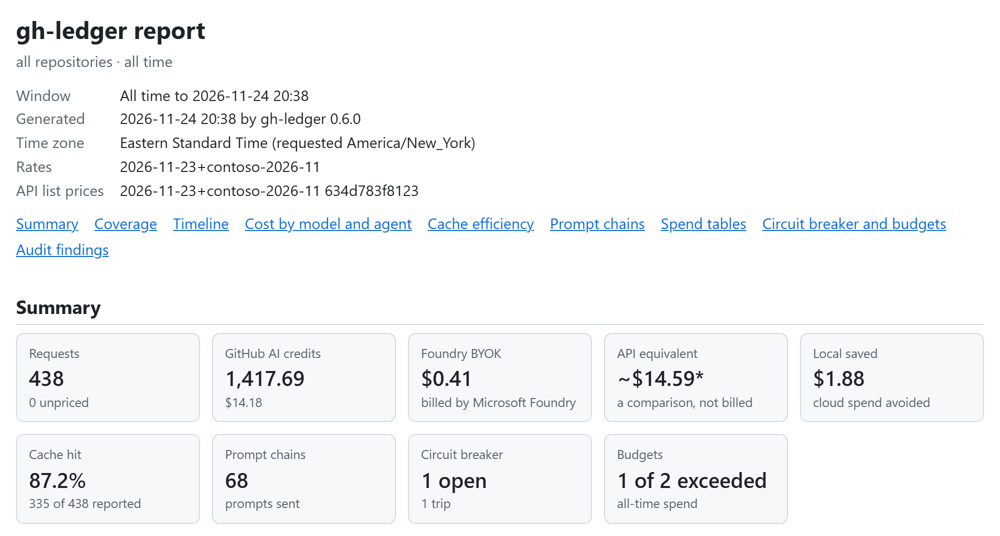

# Quickstart

Install gh-ledger, see what Copilot costs you, and try every command. Each step takes a minute or two. For every option, see the [command reference](cli.md); for walkthroughs with sample output, see the [user guide](guide.md).

## 1. Install and start recording

```shell
gh extension install swigerb/gh-ledger
gh ledger install
```

`install` sets `COPILOT_OTEL_ENABLED=true` so Copilot exports its telemetry, starts the gh-ledger daemon on `http://localhost:4318`, and registers the daemon to start when you sign in. Restart the GitHub Copilot app, VS Code, and open terminals so they pick up the setting.

Run `install` from a regular terminal. On Windows, a terminal whose job stops its processes when it closes and doesn't let them leave, such as an agent's shell in the GitHub Copilot app, can't keep the daemon running, so `install` doesn't start it there and exits with code 1.

## 2. Check that it's recording

Send Copilot a prompt in a Git repository, then run:

```shell
gh ledger status
```

`status` shows whether the daemon is running, the ledger's location, the rates version, whether Copilot's export is on, and your spend today, in the last 7 days, and in the last 30 days.

## 3. Backfill earlier sessions

```shell
gh ledger import --all --dry-run
gh ledger import --all
```

`import` records past requests from the session logs that Copilot CLI and the GitHub Copilot app keep on your machine, so you see spend from before you installed gh-ledger. It never records a request twice. To read Codex's logs too, add `--source copilot --source codex`. It exits with code 2 when some sessions can't be read, such as sessions from Copilot CLI versions before 1.0.103, and lists them.

## 4. See where the spend goes

```shell
gh ledger branch
gh ledger agents
gh ledger top-prompts
gh ledger status --cache
```

| Command | Shows |
|---|---|
| `branch` | Spend by branch in the current repository. Add `--all-repos` for every repository. |
| `agents` | Spend by agent, such as the default agent and subagents like `explore`. |
| `top-prompts` | The most expensive prompts. |
| `status --cache` | Prompt-cache hit ratios by model. Add `--by agent`, `--by branch`, or `--by pr`; `--bloat` ranks prompts by uncached input and context growth; `--turns --conversation <session ID>` lists one session's requests. |

These reports cover the last 30 days by default. Change it with `--since` (`today`, `7d`, `all`, or a date such as `2026-11-01`), narrow it with `--repo owner/repo`, and get JSON with `--json`. Spend appears in three channels: GitHub AI credits (1 credit is $0.01), Microsoft Foundry BYOK (USD), and local models such as Ollama and Foundry Local ($0.00, with the cloud spend they saved).

## 5. Find wasted spend

```shell
gh ledger audit
```

`audit` checks the last 7 days of every repository for request bursts, tool loops, retried failing commands, context bloat, prompt-cache misses, and premium models used on trivial requests. Each finding has a recommendation and, where it applies, an estimated cost. Use `--since 30d` for a longer period, `--repo owner/repo` for one repository, and `--fail-on high` to exit with code 2 in a script. `--local-llm` with `--local-llm-model` asks a model on your machine, such as one that Ollama serves, for suggestions; it sends only a summary of the findings.

## 6. Share a report

```shell
gh ledger export --bundle
gh ledger export-pr
```

`export` writes `copilot-ledger-report.html`, a self-contained report of the current repository's last 30 days that opens in any browser, offline. `--bundle` adds a ZIP with the report, its data as JSON, and SHA-256 hashes. Use `--branch`, `--pr`, `--all-repos`, or `--since` to change what it covers.



`export-pr` writes the current branch's spend receipt to `.github/copilot-ledger/receipts/`. Commit and push it; when the repository runs the [PR receipt action](https://github.com/swigerb/copilot-ledger-action), the action posts it on the pull request. `--stdout` prints the receipt instead.

## 7. Set guardrails

```shell
gh ledger budget set 500
gh ledger budget list
gh ledger breaker status
```

A budget is a soft limit in AI credits for a branch: when the branch's spend passes it, the daemon alerts you once, in `daemon.log` and with a desktop notification unless you turned them off, and nothing is blocked. `budget set` and `budget clear` act on the current branch; add `--repo` and `--branch` for another one.

The circuit breaker alerts you when one prompt spends more than 150 AI credits in 5 minutes, or when 5 tool calls in a row fail. `breaker reset` closes the current branch's open trips, and `breaker config` changes the limits, turns notifications on or off, and can write a flag file that a script can check.

## 8. Let Copilot check its own spend

Register gh-ledger's MCP server with Copilot CLI. On Windows:

```powershell
copilot mcp add ledger -- "$env:LOCALAPPDATA\GitHub CLI\extensions\gh-ledger\gh-ledger.exe" mcp
```

On macOS and Linux:

```shell
copilot mcp add ledger -- ~/.local/share/gh/extensions/gh-ledger/gh-ledger mcp
```

Copilot can then call `get_branch_ledger`, `get_top_expensive_prompts`, `get_agent_breakdown`, `get_cache_efficiency`, and `get_audit_findings`, which only read the ledger, and `set_branch_budget`. For VS Code, see [MCP server](cli.md#mcp-server).

## 9. Keep prices current

```shell
gh ledger rates update
gh ledger rates validate
```

`rates update` downloads newer published rates between releases. To price your Foundry BYOK models or correct a price, create an overlay with `gh ledger rates init`, edit it, and check it with `rates validate`; see [Configuration](configuration.md). Restart the daemon after changing rates. `rates backfill-api-equivalent` prices requests that were recorded without an API-equivalent price.

## 10. Manage the daemon, upgrade, or uninstall

```shell
gh ledger daemon stop
gh ledger daemon start
```

`daemon run` runs it in the foreground instead. To upgrade, stop the daemon, copy your data directory, and run `gh extension upgrade ledger`; follow [the upgrade steps](guide.md#upgrade-or-uninstall), because a new version can upgrade the ledger's format.

To remove gh-ledger, run `gh ledger uninstall`. If you registered the MCP server, run `copilot mcp remove ledger`. Then close the Copilot sessions that use it, and run `gh extension remove ledger`. Your ledger stays in the data directory, `~/.copilot-ledger` or the folder that `COPILOT_LEDGER_HOME` names, until you delete it.

## Every command

| Command | What it does |
|---|---|
| `install` | Turns on Copilot's telemetry export, registers and starts the daemon |
| `uninstall` | Reverses `install`; keeps the ledger |
| `status` | Daemon state, configuration, and recent spend; `--cache` for prompt-cache efficiency |
| `branch` | Spend by branch |
| `agents` | Spend by agent |
| `top-prompts` | The most expensive prompts |
| `import` | Records past requests from Copilot's and Codex's session logs |
| `audit` | Finds signs of wasted spend |
| `export` | Writes an offline HTML report and, with `--bundle`, its data |
| `export-pr` | Writes the current branch's pull request receipt |
| `budget set`, `budget list`, `budget clear` | Soft AI-credit budgets for branches |
| `breaker status`, `breaker reset`, `breaker config` | The runaway-loop circuit breaker |
| `rates init`, `rates validate`, `rates update`, `rates backfill-api-equivalent` | Prices and the rates overlay |
| `daemon run`, `daemon start`, `daemon stop` | The local receiver for Copilot's telemetry |
| `mcp` | The MCP server that Copilot runs |

Run any command with `--help` for its options.
